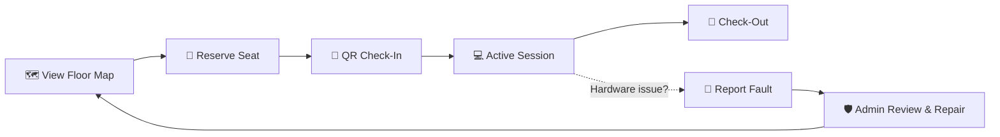

<div align="center">

# 🏛️ SmartLab
### *Intelligent Computer Lab Occupancy & Equipment Management System*

[](https://developer.mozilla.org/en-US/docs/Web/HTML)
[](https://developer.mozilla.org/en-US/docs/Web/CSS)
[](https://developer.mozilla.org/en-US/docs/Web/JavaScript)
[](#%EF%B8%8F-architecture--design-philosophy)
[](#)

*One workflow. One source of truth. Honest by design.*

---

[✨ Features](#-features-that-matter) •
[🔐 Demo Credentials](#-demo-credentials) •
[🎨 Royal Palette](#-royal-design-system) •
[🚀 Quick Start](#-quick-start) •
[🗂️ Structure](#%EF%B8%8F-project-structure)

</div>

---

## 🎯 Why SmartLab?

University computer labs often suffer from four everyday bottlenecks:
1. **Invisible Availability** — Students wander the floor looking for a free seat.
2. **Double Bookings & Long Queues** — Conflicting manual schedules waste lab time.
3. **Forgotten Faults** — Hardware issues are mentioned verbally and never tracked.
4. **Zero Utilization Data** — Lab staff lack analytics on peak hours and broken equipment.

**SmartLab** solves this with a single, cohesive, royal-grade web portal—built around an **honest occupancy** model (every state is backed by explicit user reservations, QR-verified check-ins, and check-outs, with no exaggerated sensor claims).

---

## 🔄 One Clean Workflow



---

## ✨ Features That Matter

### 🎓 Student Portal
| Feature | Description |
| :--- | :--- |
| **📊 Interactive Dashboard** | Live stats (`Available Seats`, `My Reservations`, `Active Check-In`, `Faults Reported`) with clickable drill-down cards, notifications bell, and lab announcements. |
| **🗺️ Horizontal Floor Map** | 24 workstations (`WS-001` – `WS-024`) arranged in clean horizontal rows with live status filtering (`Available`, `Reserved`, `Checked In`, `Out of Service`) and asset bundle inspection. |
| **📅 Smart Reservations** | Date & time-slot picker (`08:00` – `20:00`) with automatic conflict detection to prevent double bookings. |
| **📱 QR Check-In / Check-Out** | Desk QR validation (`SL-QR-001`, etc.) with a live running session timer and one-click check-out. |
| **🔧 Fault Reporting** | Component-level issue reporting (`Computer`, `Monitor`, `Keyboard`, `Mouse`, `Desk/Chair`, `Network`, `Power`) with `Low` / `Medium` / `High` severity tags. |
| **🪪 Student Profile & ID QR** | Personal activity summary, session history, and a dynamically generated Student ID QR code. |

### 🛡️ Administrator Command Centre
| Feature | Description |
| :--- | :--- |
| **📈 Command Centre** | Real-time lab utilization meter, peak-hours bar chart, open fault alerts, and status breakdown. |
| **🖥️ Workstation & Asset Mgmt** | Full inventory of each workstation bundle (`PC`, `Monitor`, `Keyboard`, `Mouse`, `Desk`, `Chair`) with one-click `Mark Out of Service` / `Return to Service`. |
| **⚠️ Fault & Maintenance Workflow** | Triage reports across `Open`, `In Progress`, and `Resolved` tabs with maintenance notes. |
| **📊 Deep Analytics** | SVG utilization donut chart, peak usage hours, most problematic workstations, and slot demand breakdown. |
| **📋 Immutable Audit Log** | Append-only record of every `LOGIN`, `RESERVE`, `CANCEL`, `CHECKIN`, `CHECKOUT`, and `FAULT` action—with **CSV Export**. |
| **📢 Lab Announcements** | Broadcast `Normal`, `Urgent`, or `Informational` notices directly to student dashboards. |

---

## 🔐 Demo Credentials

Use the role toggle on **`pages/login.html`** to sign in as either a Student or an Administrator:

| Role | Email | Password | Portal |
| :--- | :--- | :--- | :--- |
| **🎓 Student** | `student@smartlab.edu` | `student123` | `pages/student-dashboard.html` |
| **🛡️ Admin** | `admin@smartlab.edu` | `admin@SL2026` | `pages/admin-dashboard.html` |

---

## 🎨 Royal Design System

Crafted to feel editorial, authoritative, and refined—avoiding generic neon/AI gradients:

| Token | Hex | Swatch | Role |
| :--- | :--- | :---: | :--- |
| **Deep Navy** | `#0D1B2A` |  | Topbars, sidebars, primary headers |
| **Warm Gold** | `#C9A84C` |  | Primary CTAs, borders, active highlights |
| **Royal Pearl** | `#F4F0E8` |  | Warm canvas background |
| **Emerald** | `#1A7A4A` |  | Available & resolved states |
| **Crimson** | `#C0392B` |  | Faults & out-of-service alerts |

- **Display Typography:** `Playfair Display` (Serif) for headings, brand identity, and KPI numbers.
- **UI Typography:** `Inter` (Sans-Serif) for crisp readability across tables, forms, and navigation.

---

## 🏗️ Architecture & Design Philosophy

SmartLab follows a **Layered Modular Monolith** pattern:
- **Identity & Access** (`login`, `logout`, `requireAuth`)
- **Occupancy & Booking** (`createReservation`, `cancelReservation`, `checkIn`, `checkOut`)
- **Asset Management** (Per-workstation hardware bundle tracking)
- **Fault & Maintenance** (`createFaultReport`, `updateFaultStatus`)
- **Analytics & Audit** (`getAnalytics`, `addAuditLog`)

> **Honest Occupancy Principle:** QR codes identify the workstation—they never replace user authentication. Timeouts and occupancy states are explicit business rules rather than simulated hardware telemetry.

---

## 🗂️ Project Structure

```text
SmartLab/
├── index.html                    # Landing page with live lab preview grid
├── css/
│   └── global.css                # Complete royal design system & responsive layout
├── js/
│   └── app.js                    # State engine, auth, booking rules, QR generator & helpers
└── pages/
    ├── login.html                # Dual-role sign-in (Student / Administrator)
    ├── student-dashboard.html    # Student overview with clickable KPI cards
    ├── floor-map.html            # Horizontal interactive 24-seat floor map
    ├── reservations.html         # Slot-based booking & reservation history
    ├── checkin.html              # QR scanner UI, manual entry & live session timer
    ├── fault-report.html         # Hardware fault submission & tracking
    ├── profile.html              # Student details & personal ID QR code
    ├── admin-dashboard.html      # Admin command centre
    ├── admin-workstations.html   # Workstation & asset bundle management
    ├── admin-faults.html         # Fault triage & maintenance notes
    ├── admin-analytics.html      # Utilization charts & demand insights
    ├── admin-audit.html          # Searchable audit trail + CSV export
    └── admin-announcements.html  # Lab notice composer
```

---

## 🚀 Quick Start

No build tools or dependencies required. Clone and serve locally:

```bash
# 1. Clone the repository
git clone https://github.com/Ayushgupta0511/SmartLab.git
cd SmartLab

# 2. Start a local HTTP server
python3 -m http.server 8787

# 3. Open in your browser
open http://localhost:8787
```

---

<div align="center">

**Built with precision for intelligent lab management.**  
*Software Architecture Design & Testing — Group 4*

</div>
